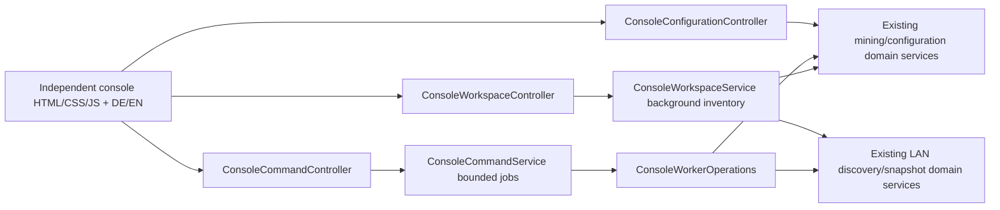

# PC-Agent frontend audit and new operations console / Frontend-Analyse und neue Betriebskonsole

2026-10-20. Scope: the standalone `pc-agent` repository, existing static pages,
HTTP adapters, live transport and LAN worker control. Read-only source audit before
implementation; no live GPU, real-pool, accessibility certification or measured
old/new browser performance claim is implied. Existing files/controllers remain.

## Analysis (English)

### Existing strengths

- Framework-free, same-origin static deployment; no external fonts or browser CDN.
- `core/live-data.js` already has bounded session snapshots, in-flight request
  coalescing, request timeouts, visibility handling, REST freshness and SSE.
- `WorkerController` owns start/pause, persisted manual-stop semantics and mode
  handling. Existing services enforce run locks and hardware prerequisites.
- `NetworkDashboardService.cards()` is an in-memory read; LAN collection is
  background work (the sequential-submission bug below was found during the audit). Discovery, visibility consent and command permission are
  deliberately distinct. Older peers remain monitorable.
- A closed German/English catalog exists; unknown sensors and absent share
  counters generally remain unavailable rather than being fabricated.

### Findings and resulting requirements

| Priority | Evidence and user impact | New console response |
| --- | --- | --- |
| P1 | `pages/overview.js:renderDashboardWorkers` uses `replaceChildren(ui.table(...))`; overview, energy, telemetry and network subscriptions can trigger it. `workers.js` similarly reconstructs views. Focused controls and selected DOM nodes can disappear during updates. | Keyed row reuse; change cell text only when changed; stable toolbar and detail panel. |
| P1 | Local `WorkerView`, live `MinerStats.Worker` and peer `WorkerRow` differ. Assignment and live algorithm can diverge (BUG-004); assigning the saved coin to active hashrate mislabels production. | Explicit configured coin and observed algorithm; local telemetry provides actual algorithm, mode, shares and temperature. No cross-algorithm summed hashrate. |
| P1 | Network snapshot collection is 5 s, peer cache TTL 4 s, request timeout 1.5 s, discovery TTL 20 s. Local REST polling is another 5 s. A successful browser request does not establish source freshness. | Display source timestamp/age and mark stale sources independently of HTTP connectivity. Disable commands when a source is stale. |
| P1 | LAN visibility, global external permission and per-worker consent differ. An older peer's null permission cannot grant control. | Per-row typed blocking reason; server checks identity, freshness and permissions again; destination remains authoritative. Local commands keep local rights; new domain adapters never invoke the old controllers. |
| P1 | Existing command contracts mix booleans, `{applied,error}` and HTTP exceptions. Browser HTTP 200 alone is not evidence of a successful action. Long sequential miner startup can occupy a request. | Explicit accepted job, per-target queued/running/succeeded/failed results, no automatic write retry; bounded queue and duplicate-target exclusion. Success means service accepted/applied the command, not pool shares. |
| P2 | Existing dashboard builds an unbounded worker table and repeats filters/grouping across subscribers. A card per GPU is expensive and makes fleet scanning difficult. | Server filtering and pagination, at most 50 visible rows, selectable batches, stable deterministic ordering and independent machine overview. |
| P2 | `design.css` has 2,090 lines layered over `agent.css` and `workspace.css`; old top-level HTML repeats navigation and numerous chrome scripts. Full navigation resets UI state and recreates subscriptions. | Isolated console styles and scripts; one operations view, contextual detail dialog, URL-backed filters; legacy pages available for advanced tasks. |
| P2 | Existing SSE sends changed snapshots; no periodic heartbeat. The client age watchdog can REST-refresh unchanged healthy data. `open()` resets reconnect backoff before a successful connection. These are reliability/load risks, not a measured outage. | Deliberate non-overlapping REST polling for this cached, paginated fleet view; bounded backoff, hidden-tab suspension, abort superseded reads. Existing SSE remains untouched for specialist pages. |
| P2 | Overview mixes software updates, driver prerequisites, tariff, telemetry, economic estimates and worker operations in the primary scanning path. Different coins cannot share a meaningful aggregate H/s. | Prioritize active/total workers, issues, available reported mining watts, machines; details and specialist links are secondary. Do not introduce an unqualified fleet-profit total. |
| P2 | No paginated multi-worker control flow is present in the existing physical-worker page. Independent per-click actions offer little fleet feedback. | Page selection, explicit Start/Pause action, individual outcomes including partial failures; never silently start an entire fleet. |
| P2 | Accessibility depends on regenerated controls; row selection and responsive large tables need deliberate semantics. | Native table, labelled form controls, visible keyboard focus, status live region, native modal focus handling, mobile overflow and reduced-motion support. |

### Limits and verification plan

Source findings describe actual code patterns; responsiveness improvements need
browser verification with large deterministic fixtures and ultimately real rigs.
Exercise slow/offline/forbidden peers, missing telemetry, unassigned devices,
starting workers, duplicate clicks, partial batch failures and both locales.
Tests must cover read bounds, source freshness, permission isolation, async
admission and direct domain-service dispatch. Preserve all old APIs and assets.
The console is additive at `/console/index.html`; `/` stays the old dashboard.
Installation, assignment and local LAN-visibility/control settings have independent
new API/UI flows. The initially missing specialist editors are now available independently at
`/console/tools.html`; see [the tools contract](frontend-console-tools.md).
Old pages remain separately available for comparison; no old script,
stylesheet, translation runtime or HTTP controller is used by the new console. Local peer control is Start/Pause;
remote driver/configuration changes remain outside the existing LAN contract.

## Analyse (Deutsch)

Die bisherige Oberfläche besitzt bereits REST-Caches, SSE, zweisprachige Texte
und eine bewusst getrennte LAN-Freigabe und Fernsteuerung. Ein pauschaler
Neuaufbau ohne diese Regeln würde bestehende Fähigkeiten verlieren.

Die wesentlichen durch den Quellcode belegten Probleme sind wiederholter
Neuaufbau ganzer Worker-Tabellen, mehrere abweichende Worker-Datenmodelle,
zusätzliche Verzögerung durch periodische LAN-Abfragen, uneinheitliche
Befehlsantworten und eine nicht begrenzte Anzahl dargestellter Worker.
Die vielen Seiten und übereinanderliegenden CSS-Schichten erschweren eine
konsistente Bedienung. Der SSE-Watchdog und die Rücksetzstelle des
Reconnect-Backoffs können zusätzliche Last erzeugen; eine reale Störung oder
ein bestimmter Geschwindigkeitsgewinn wurden dadurch noch nicht gemessen.

Die neue Betriebskonsole priorisiert Worker und Agents. Sie verwendet
serverseitige Suche und Filter, begrenzte Seiten, stabile Tabellenzeilen,
explizites Datenalter, nachvollziehbare Sperrgründe und eine Detailansicht.
Sammelaktionen erhalten einzelne Ergebnisse und werden nur auf ausgewählte
Worker angewendet. Fehlende Messwerte bleiben unbekannt; Hashraten
verschiedener Algorithmen werden nicht addiert. Lokale Aktionen verwenden
eigene Controller und direkte Fachdienst-Aufrufe; Fernaktionen verwenden den
bestehenden LAN-Fachdienst. Alte Controller oder Frontend-Dateien werden nicht
wiederverwendet.
Freigaben, Messsperren und Startvoraussetzungen bleiben maßgeblich.

Alte Oberfläche und Controller bleiben verfügbar. Die neue Konsole liegt
unter `/console/index.html`, die bisherige Startseite weiter unter `/`.
Softwareinstallation, Worker-Zuweisung sowie Agent-Name und LAN-Freigaben sind
in der neuen Konsole eigenständig bedienbar. Wallet-, Benchmark-, Update-, Leistungsgrenzen-, Auto-Tuning- und Diagnose-
Werkzeuge sind inzwischen unabhängig unter `/console/tools.html` implementiert.
Ihre alten Seiten bleiben zum Vergleich separat verfügbar. Fernsteuerung umfasst
Start/Pause; Änderungen an entfernten Treibern oder Konfigurationen werden
nicht neu freigegeben.

Die Prüfung umfasst Java-Vertragstests, zweisprachige Katalogprüfung und
Browser-Szenarien mit vielen künstlichen Workern. Hardware-, Pool- und
Produktionsnachweise sind davon getrennt und werden nicht behauptet.


## Additional verified finding / Zusätzlich bestätigter Befund

**P1 — sequential LAN collection despite asynchronous-looking code.** The original
`refreshSnapshot()` used a single lazy stream with `supplyAsync(...).map(join)`.
Java requests each result before proceeding to the next source element, so it
submitted one peer and joined it before submitting the next. Collection latency
could therefore accumulate across offline/slow agents. The shared *domain service*
now materializes all submissions before joining. A two-server barrier test
(`NetworkCollectorConcurrencyTest`) proves that both requests arrive before
either response is released. No external LAN API or old controller changed.

**Deutsch:** Die scheinbar parallele LAN-Abfrage war durch eine verzögerte
Stream-Auswertung tatsächlich sequenziell. Die korrigierte Fachdienst-Pipeline
startet alle Anfragen vor dem Warten. Zwei lokale Testserver bestätigen die
Überlappung ohne eine behauptete Produktions-Latenzmessung.

## Implemented architecture / Umgesetzte Architektur



- New files are under `static/console/`, Java `console/` and the three
  `Console*Controller` files. No new controller depends on an old controller.
  The same-origin `AgentWriteAccessFilter` protects the entire new namespace.
- `GET /api/agent/local/operations/workspace?q=&agent=&state=&page=0&size=50`
  returns machine metadata, whole-fleet counters and a filtered, deterministically
  ordered page. Size is clamped to 1–50; page is clamped to available results.
  `GET /worker?agent=&device=` is the exact scoped detail read.
- Local inventory is collected every 2 seconds only while a console consumer
  was active in the last 60 seconds. Reads never discover hardware or fetch peers.
  Failed collection retains the previous timestamp. Peers retain the LAN
  collector's successful-fetch timestamp. The existing external peer payload
  has no independent per-sensor timestamp: this cannot prove remote sensor
  freshness; no such guarantee is claimed.
- Local source age >8 s and peer fetch age >15 s disable control. The browser
  checks age even between reads. Offline HTTP does not erase the last snapshot.
  Null/missing metrics remain unavailable. Wattage is explicitly **reported mining
  power**, based on domain telemetry which can be approximate, not total wall power.
- New local inventory includes unassigned devices. Old peers without device IDs
  receive distinct display-row identities and remain unconditionally read-only.
  Configured coin/software are distinct from observed live algorithm. Live shares
  are miner-native; no pool payout, cross-algorithm hashrate or invented profit total.
- `POST .../commands` accepts `{action: start|pause|assign, targets:[{agentId,
  deviceId}], assignment?:{coin,minerSoftwareId}}`. HTTP 202 is acceptance only.
  `GET .../commands/{id}` supplies individual queued/running/succeeded/failed
  results. Jobs execute at most two at a time, with a queue of 16 and at most
  64 targets per request. Target reservations reject duplicates. Completed jobs
  are retained for up to 30 minutes with a 128-job memory bound; expiration is
  checked on admission. UI retains eight completed jobs plus in-progress jobs.
- Job state is process-local. Agent restart loses history; a missing result never
  causes an automatic write retry. A lost HTTP acceptance response is explicitly
  ambiguous. The user is instructed to inspect state before sending another action.
- Local starts and assignments take the shared measurement lock. Revenue-mode
  start uses `WorkerAssignmentService.startWithHeldRunLock`; no mining selection
  logic is copied into the new controller. Pause preserves manual-stop and
  revenue-cooldown semantics and can cancel the device's tuning through the domain.
  Peer commands retain destination visibility/global/per-worker authorization.
- `GET/POST .../configuration/software` uses the domain miner catalog and explicit
  install action. Experimental miners remain visible/selectable when their real
  prerequisites allow it. Assignment is a local asynchronous job, not a hidden
  start. `GET/PUT .../configuration` owns only name, LAN visibility and global
  remote-control switches; assignments, per-worker consent and wallet-sharing
  consent are preserved.
- The independent closed catalog is in `console/i18n.js`; both locales share the
  existing language *preference value*, not its implementation. Known domain
  failures become translatable codes. Hardware/coin/software names, URLs and
  device identifiers stay verbatim. Unknown external miner/driver diagnostics
  remain verbatim only inside an explicitly labelled diagnostic disclosure.
  Internal unexpected exceptions do not expose stack traces.
- Polling uses completion-based scheduling (2 s after a read), 8 s timeout,
  abort/version guards, hidden-tab suspension and bounded failure backoff. This
  deliberately avoids reusing the old SSE/watchdog implementation. It trades
  subsecond push for a simpler bounded operations contract; the underlying
  miner/peer sampling cadence still determines freshness.
- UI patches keyed row/cell nodes, bounds the table scroll area and page size,
  keeps selection scoped to a page, preserves keyboard focus, uses native modal
  focus behavior, labels inputs and supports mobile overflow/reduced motion.
  Server filtering remains O(N) and sorting O(N log N); only DOM/page transfer
  are bounded. The mock browser test is not a server throughput benchmark.

## Specialist tools completed / Spezialwerkzeuge ergänzt

The initially outstanding wallet/pool, benchmark/sweep, manual power/clock,
Auto Tuning goal, update and raw-console workflows are now implemented with
independent assets and the new `ConsoleToolsController`. See
[frontend-console-tools.md](frontend-console-tools.md) for contracts, limits and
verification. Shared domain services retain mining, driver and permission rules.
No remote driver/configuration writes have been added to the LAN contract.
Real hardware, pool accounting and supervised-launcher update acceptance remain
unverified by the synthetic browser tests.

Deutsch: Die zunächst ausstehenden Wallet-/Pool-, Benchmark-/Sweep-, Leistungs-/
Takt-, Auto-Tuning-, Update- und Konsolenfunktionen sind jetzt eigenständig
umgesetzt. Der verlinkte Werkzeugvertrag beschreibt Verhalten und Grenzen.
Reale Hardware-, Pool- und Launcher-Abnahmen werden nicht durch die simulierten
Browserprüfungen ersetzt. Die Fernsteuerung erhält keine neuen Treiberrechte.

## Verification / Prüfung

- JDK 21 full `test standaloneJar --offline` including independent console read,
  command, HTTP-origin, configuration-preservation, measurement-lock and real
  loopback LAN-concurrency tests. Hardware services are mocked in console tests.
- `node scripts/check-operations-i18n.cjs`: new catalog and parameters in DE/EN,
  static and dynamic keys, typed API failure codes, no old controller imports or
  frontend asset dependencies.
- Existing catalog, literal scan and static render checks remain applicable to
  the retained UI and run separately.
- `scripts/check-operations-browser.cjs` with Playwright/Chromium: deterministic
  2,000-worker fixture, 50-row DOM bound, search/pagination, preserved row identity
  and focus, native dialog/Escape, permission refusal, stale/offline reads, partial
  50-target batch, no automatic write retry, explicit install/assignment/settings,
  DE/EN reload and 390 px mobile viewport. It intercepts *every* API request and
  fails if the console calls an old API. No real miners are started by this test.
- No deployment, real-GPU, live LAN control, actual pool accounting, old/new
  Lighthouse comparison or assistive-technology certification has been performed.

Browser check setup (optional developer tooling outside the repository):

```sh
npm install --prefix /tmp/solarminer-console-browser playwright
NODE_PATH=/tmp/solarminer-console-browser/node_modules node scripts/check-operations-browser.cjs
```

Set `OPERATIONS_BROWSER` to an existing Chromium executable if the installed
Playwright browser is not available. Browser runtime libraries must exist on the
host. These tooling paths are not application dependencies.


## Detaillierte Bewertung für Betreiber (Deutsch)

| Bereich | Bewertung des bisherigen Frontends | Konsequenz im neuen Frontend |
| --- | --- | --- |
| Erstes Laden | Viele unabhängige Seiten- und Shell-Abfragen; ein Teil ist bereits korrekt zwischengespeichert. Ein neuer Framework-Stack allein würde die Datenabhängigkeiten nicht lösen. | Eigenständige, kleine Asset-Gruppe; ein begrenztes Betriebsmodell statt vieler miteinander verkoppelter Dashboard-Abfragen. |
| Laufende Darstellung | Wiederholtes Ersetzen der gesamten Worker-Tabelle kann Tastaturfokus und Bedienelemente verlieren. Die konkrete Wirkung hängt von Worker-Anzahl und Browser ab. | Vorhandene Zeilen und Zellen bleiben bestehen; nur geänderte Inhalte werden gesetzt. Der Browser-Test prüft Objektidentität und Fokus nach einem Update. |
| Viele GPUs | Karten und vollständige Tabellen wachsen mit jedem Gerät. Such- und Renderarbeit wird über mehrere Abonnenten wiederholt. | Serverseitige Filter, maximal 50 ausgelieferte Zeilen, begrenzter Scrollbereich, Seitenwahl und seitenspezifische Sammelauswahl. |
| LAN-Aktualität | Erfolgreiche Browser-Abfrage und frische Messquelle sind unterschiedliche Aussagen. Der bestehende Peer-Vertrag liefert keine eigene Sensorzeit. | Quellalter pro Agent; ab 8 Sekunden lokal bzw. 15 Sekunden bei Peers wird Steuerung gesperrt. Fehler frischen alte Daten nicht auf. |
| LAN-Latenz | Die ursprüngliche verzögerte Stream-Pipeline startet und wartet pro Peer nacheinander. Mehrere langsame Agents addieren Wartezeit. | Anfragen werden zuerst vollständig gestartet und dann zusammengeführt. Ein Barriere-Test mit zwei HTTP-Servern bestätigt die Überlappung. |
| Befehlsbestätigung | Boolean, HTTP-Status und strukturierter Fehler werden bisher uneinheitlich behandelt. Ein gestarteter Prozess ist noch kein Pool-Erfolg. | HTTP 202 bedeutet Annahme. Jeder Worker hat ein eigenes Ergebnis. Hashrate und Shares bestätigen separat den Betriebszustand. |
| Bedienung von Ausfällen | Ohne bewusst getrennte Zustände kann ein alter Zahlenstand wie ein aktueller Zustand wirken. Ein Timeout beim Schreiben kann zu Doppelaktionen verleiten. | Letzter Stand bleibt mit Verbindungs-/Altersanzeige sichtbar; Steuerung ist gesperrt. Schreibaktionen werden bei unklarer Antwort nicht automatisch wiederholt. |
| Rechte und Datenschutz | LAN-Sichtbarkeit, globale Steuerung und Worker-Freigabe sind bewusst unterschiedliche Schalter. Alte Peers melden Felder teilweise nicht. | Beide Seiten prüfen Rechte. Fehlende Worker-Identität oder Freigabe ergibt reine Anzeige; lokale Rechte hängen nicht von der LAN-Freigabe ab. |
| Einrichtung | Daten aus Installation, Zuweisung und Laufzeit dürfen nicht gleichgesetzt werden. | Eigene Installationsaktion, eigene Zuweisungsaktion, separater Start. Experimentelle Miner bleiben bei erfüllten tatsächlichen Voraussetzungen sichtbar. |
| Verständlichkeit | Treibervoraussetzungen, Updates, Tarif, Messungen und Betriebssteuerung konkurrieren auf der bisherigen Übersicht. | Betrieb, Worker, Agents und Aktionsverlauf stehen im Vordergrund. Identität, Konfiguration und Messwerte erscheinen im Detaildialog. |
| Kennzahlen | Hashraten verschiedener Algorithmen sind nicht sinnvoll addierbar. Gemeldete Miner-Leistung ist nicht automatisch gemessener Gesamtverbrauch am Stromanschluss. | Keine algorithmusübergreifende Gesamt-Hashrate und kein erfundener Gewinn. Die Watt-Kennzahl heißt ausdrücklich gemeldete Mining-Leistung. |
| Barrierefreiheit und Mobilgeräte | Dynamische Tabellen und viele Navigationselemente benötigen explizite Fokus- und Überlaufbehandlung. | Native Tabelle und Modal-Dialog, beschriftete Eingaben, sichtbarer Fokus, Statusmeldungen und begrenzter Tabellenüberlauf. Der 390-Pixel-Test prüft seitlichen Seitenüberlauf. |
| Wartbarkeit | Mehrere CSS-Schichten und wiederholte Seiten-Shells erschweren Änderungen und Vergleiche. | Eigenes Verzeichnis und eigene Controller. Übersetzungen und Fehlercodes werden unabhängig geprüft; alte Dateien dienen ausschließlich dem separaten Vergleich. |

Der wesentliche Architekturkompromiss ist bewusst: Die neue Betriebskonsole fragt
begrenzte, im Hintergrund gesammelte Zustände per REST ab. Das vereinfacht
Abbruch, Offline-Verhalten und Seitenwechsel, liefert aber keine garantierten
Updates unter einer Sekunde. Für einen späteren Push-Ausbau sollte dieselbe
Datenstruktur mit Revisionen und Heartbeats verwendet werden, statt den alten
SSE-Client wieder einzubinden. Erst reale Messungen mit typischer Worker-Zahl,
mehreren Browsern und langsamen Agents können einen genauen alten/neuen
Geschwindigkeitsgewinn belegen.

Die neuen API-Wege sind intern zum jeweiligen Agent. Der externe LAN-Vertrag
wird nicht erweitert; deshalb sind keine Änderungen an Node, Proxy,
Currency Service oder zentralen Abrechnungsdiensten erforderlich. Die gemeinsamen
Fachdienste bleiben Eigentümer von Mining-Prozessen, Treiberzugriff und Freigaben.
Die neuen Controller enthalten keine zweite Mining- oder Gebührenlogik.
